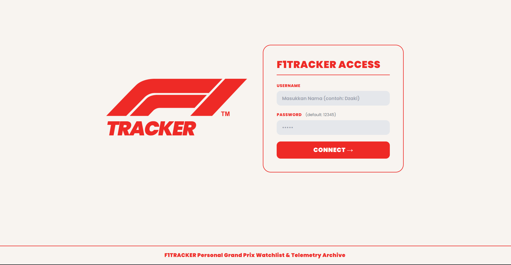
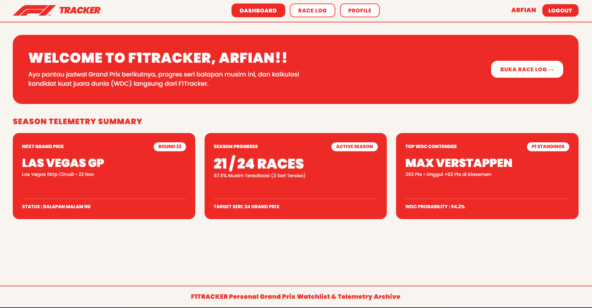
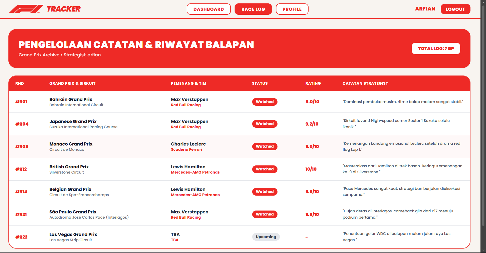
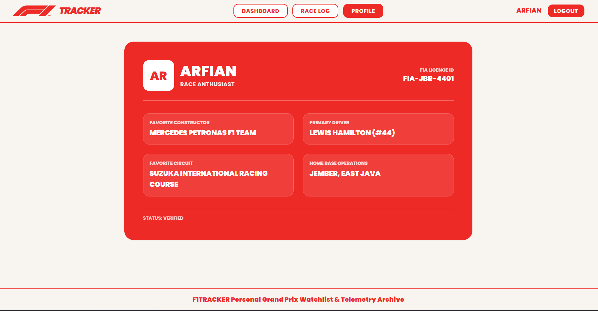

# 🏎️ F1TRACKER — Personal Grand Prix Watchlist & Telemetry Archive

Website pengelolaan riwayat balapan Formula 1 dan pemantauan telemetri musiman yang dibangun untuk memenuhi Tugas UTS Pemrograman Web.

---

## 👤 Identitas Mahasiswa

- **Nama:** [Isi Nama Lengkap Kamu]
- **NIM:** 252410102014
- **Kelas:** [Isi Kelas Kamu, misal: PWEB B]
- **Repository:** [UTS_PWEB_252410102014](https://github.com/ArfianYanPian/UTS_PWEB_252410102014)

---

## 📌 Penjelasan Singkat Website

**F1Tracker** adalah aplikasi berbasis web yang dirancang untuk penggemar dan _race strategist_ Formula 1. Website ini berfungsi untuk:

- Memantau jadwal Grand Prix berikutnya, progres seri balapan musim berjalan, serta estimasi statistik kandidat Juara Dunia (WDC).
- Mengelola arsip catatan balapan (_Race Log_) dari R01 hingga R22, lengkap dengan status tontonan (_Watched_ / _Upcoming_), rating, dan catatan analisis strategist.
- Menampilkan kartu identitas lisensi resmi pengguna (_Strategist Profile_).

---

## 🛠️ Teknologi & Tools

- **Framework:** PHP Laravel 11
- **Templating Engine:** Laravel Blade
- **Styling:** Tailwind CSS (via CDN)
- **Font:** Google Fonts (Poppins)
- **Icons & Assets:** F1 Official SVG Asset

---

## 📸 Screenshot Tampilan Website

### 1. Halaman Login Access



### 2. Halaman Dashboard Telemetry



### 3. Halaman Race Log (Pengelolaan)



### 4. Halaman Strategist Profile



---

## 🚀 Cara Menjalankan Project

1. **Clone repository ini:**
    ```bash
    git clone [https://github.com/ArfianYanPian/UTS_PWEB_252410102014.git](https://github.com/ArfianYanPian/UTS_PWEB_252410102014.git)
    ```
